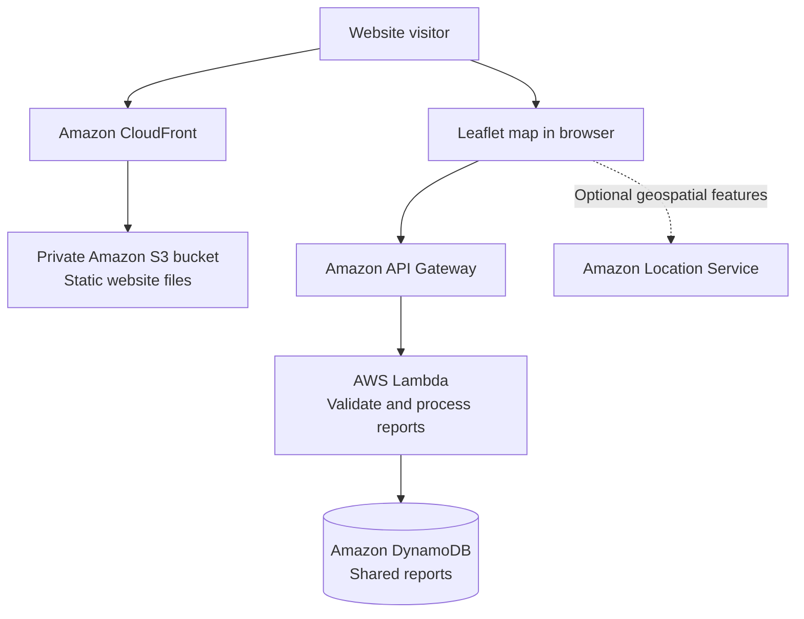

# SafePath Bengal — AWS Architecture (Not Yet Deployed)

> This is a proposal for a future deployment. It is not an implementation diagram of the current local prototype.

## Current implementation

- Browser UI: HTML, CSS, JavaScript
- Map: Leaflet with OpenStreetMap tiles
- Demo data: GeoJSON
- User-created reports: browser local storage

## Proposed AWS implementation

- CloudFront + private S3 origin using Origin Access Control
- API Gateway endpoints for creating and retrieving reports
- Lambda validation and processing
- DynamoDB table for report records and status
- Optional Amazon Location Service capabilities after checking Region availability, pricing and requirements

## Security and operations checklist before deployment

- Keep S3 Block Public Access enabled.
- Use CloudFront Origin Access Control.
- Never put AWS access keys or secret credentials in browser JavaScript.
- Validate and sanitize report input in Lambda.
- Add rate limiting and abuse controls.
- Minimize personal data and avoid collecting exact user identity unless essential.
- Set billing alerts and review service pricing before deploying.
- Clearly label reports as unverified until moderated.

## Provisioning template and local backend

The repository includes [`aws/template.yaml`](aws/template.yaml), a SAM template for private S3 + CloudFront hosting, an API Gateway HTTP API, a Lambda handler, and an encrypted on-demand DynamoDB table. It also includes `backend/local-server.mjs`, a loopback-only JSON API using the same validation rules. The SAM stack is infrastructure code only; it has not been deployed, and its API has not been tested against AWS.

Run the local API with `node backend/local-server.mjs` and open the static app with `?api=http%3A%2F%2F127.0.0.1%3A3001`. For an AWS deployment, install the AWS CLI and SAM CLI, review current service costs, then run `sam build --template-file aws/template.yaml` followed by `sam deploy --guided --template-file .aws-sam/build/template.yaml`. The guided deployment requires a new moderator token of at least 32 characters. Keep it out of source control and browser code.

The template's API Gateway stage is throttled. Public report reads and writes are intentionally unauthenticated in this prototype; only moderator status changes require the server-side token. Add account identity, audit logging, stronger abuse controls, and a private S3 image workflow before a public production launch. API list responses omit image blobs; `GET /reports/{reportId}` returns one report and its optional image on demand. API photos are currently stored in DynamoDB and are publicly readable.
